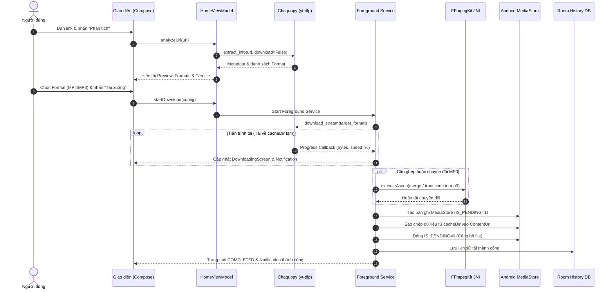

# TÀI LIỆU KIẾN TRÚC PHẦN MỀM VIBELOAD v1.0.0
## Clean Architecture & Serverless Android Media Downloader

### 1. TỔNG QUAN KIẾN TRÚC HỆ THỐNG
VibeLoad được thiết kế theo mô hình **Clean Architecture** tách biệt hoàn toàn giữa các tầng Presentation, Domain, Data và Platform Integration, tuân thủ nguyên tắc SOLID, dễ mở rộng, kiểm thử độc lập và không phụ thuộc vào bất kỳ máy chủ backend nào (hoạt động 100% On-Device / Serverless).

```mermaid
graph TD
    subgraph Presentation ["Tầng Presentation (Jetpack Compose Material 3)"]
        UI_Home["Trang chủ (Home Screen)"]
        UI_DL["Đang tải (Downloading Screen)"]
        UI_Lib["Thư viện (Library Screen)"]
        UI_Set["Cài đặt (Settings Screen)"]
        UI_Player["Trình phát tích hợp (Player Screen)"]
        VM["ViewModels (StateFlow / UIState)"]
    end

    subgraph Domain ["Tầng Domain (Nghiệp vụ thuần)"]
        UC_Analyze["AnalyzeUrlUseCase"]
        UC_Download["DownloadMediaUseCase"]
        UC_Control["ControlTaskUseCase"]
        UC_Library["ManageLibraryUseCase"]
        UC_Update["CheckUpdateUseCase"]
        Models["Models: MediaMetadata, FormatOption, DownloadTask, DownloadState"]
        Interfaces["Interfaces: DownloadEngine, StorageRepository, HistoryRepository"]
    end

    subgraph Data ["Tầng Data (Kho dữ liệu & Trạng thái)"]
        Repo_DL["DownloadRepositoryImpl"]
        Repo_Hist["HistoryRepositoryImpl"]
        Repo_Set["SettingsRepositoryImpl"]
        Room_DB["Room Database: HistoryEntity, HistoryDao"]
    end

    subgraph Platform ["Tầng Platform & Native Integration"]
        Eng_Chaquopy["Chaquopy Python Engine (yt-dlp)"]
        Proc_FFmpeg["FFmpegKit Maintained JNI (Remux & MP3 Transcode)"]
        Service_FG["DownloadForegroundService (Notification & WakeLock)"]
        Storage_Media["MediaStore Scoped Storage Manager (IS_PENDING)"]
        Exo_Player["AndroidX Media3 ExoPlayer Engine"]
    end

    Presentation --> Domain
    Domain --> Data
    Data --> Platform
```

---

### 2. PHÂN TÁCH TRÁCH NHIỆM TỪNG THÀNH PHẦN

#### 2.1. Presentation Layer (Giao diện người dùng)
- **Công nghệ:** Jetpack Compose, Material 3, Navigation Compose, Compose ViewModel.
- **Thành phần:**
  - `HomeScreen`: Nhận URL, tương tác dán clipboard, gọi phân tích liên kết, chọn chất lượng/định dạng (Video MP4, MP3 bitrate, Audio gốc), sửa tên file và khởi chạy tác vụ.
  - `DownloadingScreen`: Giám sát tác vụ tải duy nhất đang chạy, hiển thị tiến trình thời gian thực (%, tốc độ, dung lượng, ETA), cung cấp các nút Tạm dừng, Tiếp tục, Hủy, Thử lại.
  - `LibraryScreen`: Hiển thị danh sách tập tin theo danh mục (Video, Âm thanh, Lịch sử), hỗ trợ tìm kiếm, lọc, sắp xếp, đổi tên, chia sẻ và mở trình phát.
  - `SettingsScreen`: Lựa chọn chủ đề (Sáng/Tối/Hệ thống), dọn dẹp cache/file tạm, xóa lịch sử, kiểm tra cập nhật APK qua GitHub Releases.
  - `PlayerScreen`: Tích hợp `AndroidView(PlayerView)` điều khiển phát media với Media3.

#### 2.2. Domain Layer (Nghiệp vụ cốt lõi)
- Không phụ thuộc vào Android SDK hay bất kỳ thư viện bên ngoài nào, bảo đảm khả năng viết Unit Test độc lập hoàn toàn.
- **Mô hình thực thể (Models):**
  - `MediaMetadata`: Tiêu đề, thumbnail URL, tác giả, thời lượng, nền tảng nguồn, danh sách format.
  - `FormatOption`: Định dạng (MP4, MP3, M4A, Opus), độ phân giải (360p - 4K), bitrate (128k - 320k), dung lượng ước tính.
  - `DownloadTask`: ID tác vụ, URL gốc, tên file đã chuẩn hóa, format đã chọn, tiến trình (%), tốc độ (bytes/s), trạng thái hiện tại.
  - `DownloadState`: Máy trạng thái hữu hạn tiêu chuẩn:
    `IDLE -> RESOLVING -> READY -> DOWNLOADING -> PROCESSING -> SAVING -> COMPLETED` (và các trạng thái phụ: `PAUSED`, `RETRYING`, `FAILED`, `CANCELLED`).

#### 2.3. Data Layer (Dữ liệu cục bộ)
- `HistoryRepository`: Quản lý danh sách file đã tải thành công thông qua Room Database (`vibeload_history.db`).
- `SettingsRepository`: Quản lý cấu hình chủ đề giao diện và thiết lập người dùng.

#### 2.4. Platform Layer (Tích hợp hệ thống Android)
- `ChaquopyDownloadEngine`: Cầu nối JNI giữa Kotlin và Python 3.11, thực thi thư viện `yt-dlp` để bóc tách thông tin stream và tải trực tiếp về file tạm nội bộ (`cacheDir/vibeload_temp/`).
- `FFmpegMediaProcessor`: Sử dụng `dev.ffmpegkit-maintained:ffmpeg-kit-full` thực hiện ghép luồng âm thanh và hình ảnh độc lập thành MP4 chuẩn hoặc chuyển mã sang MP3 với bitrate chỉ định (128k, 192k, 256k, 320k) bằng bộ mã hóa LAME.
- `MediaStoreStorageManager`: Quản lý xuất bản file sang bộ nhớ chung của hệ thống Android:
  - Video -> `Movies/VibeLoad/`
  - Âm thanh -> `Music/VibeLoad/`
  - Áp dụng cơ chế an toàn `IS_PENDING = 1` trong suốt thời gian ghi, chỉ mở cờ `IS_PENDING = 0` khi tệp tin đã được chuyển đổi hoàn tất và xác thực hợp lệ.
- `DownloadForegroundService`: Quản lý chạy nền, duy trì WakeLock, cập nhật Notification thanh tiến trình với các hành động tương tác (Tạm dừng, Hủy).

---

### 3. LUỒNG XỬ LÝ DỮ LIỆU CHUẨN (LIFECYCLE TÁC VỤ TẢI)

